<!-- Generated by gen/build.py: edit data/profile.json and rebuild. -->

<a href="https://github.com/laloba04/laloba04/blob/main/README.md">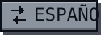</a>

<picture>
  <source media="(max-width: 600px)" srcset="https://github.com/laloba04/laloba04/raw/main/assets/en/mobile/hero.svg?v=9d81e01b">
  
</picture>

<picture>
  <source media="(max-width: 600px)" srcset="https://github.com/laloba04/laloba04/raw/main/assets/en/mobile/sheet.svg?v=67042185">
  
</picture>

<picture>
  <source media="(max-width: 600px)" srcset="https://github.com/laloba04/laloba04/raw/main/assets/en/mobile/stats.svg?v=b8317c5b">
  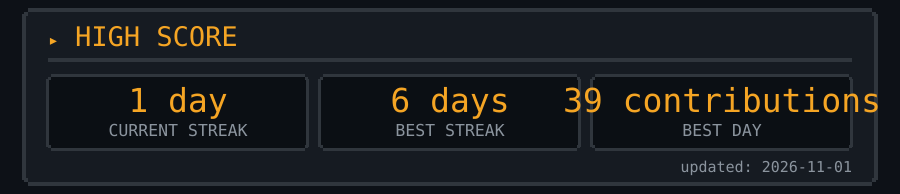
</picture>

<picture>
  <source media="(max-width: 600px)" srcset="https://github.com/laloba04/laloba04/raw/main/assets/en/mobile/achievements.svg?v=536a484e">
  
</picture>

<picture>
  <source media="(max-width: 600px)" srcset="https://github.com/laloba04/laloba04/raw/main/assets/en/mobile/inventory.svg?v=b6bb8b91">
  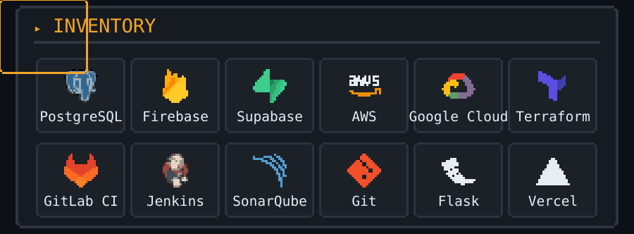
</picture>

<picture>
  <source media="(max-width: 600px)" srcset="https://github.com/laloba04/laloba04/raw/main/assets/en/mobile/quests-title.svg?v=315124ca">
  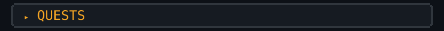
</picture>

<a href="https://mariaba.pages.dev">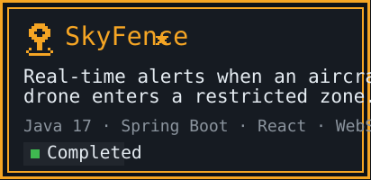</a>
<a href="https://mariaba.pages.dev">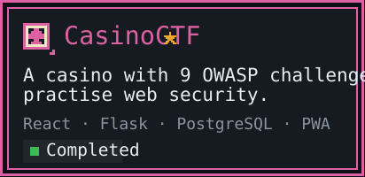</a>
<a href="https://mariaba.pages.dev">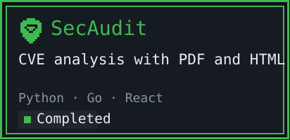</a>
<a href="https://mariaba.pages.dev">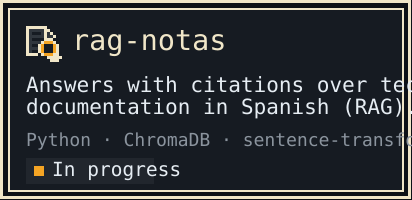</a>

<a href="https://mariaba.pages.dev">
<picture>
  <source media="(max-width: 600px)" srcset="https://github.com/laloba04/laloba04/raw/main/assets/en/mobile/quests-more.svg?v=53093bbe">
  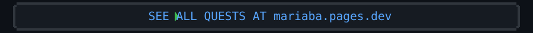
</picture>
</a>

<picture>
  <source media="(max-width: 600px)" srcset="https://github.com/laloba04/laloba04/raw/main/assets/en/mobile/night.svg?v=ca00057f">
  
</picture>

<a href="mailto:mba.maria08@gmail.com">
<picture>
  <source media="(max-width: 600px)" srcset="https://github.com/laloba04/laloba04/raw/main/assets/en/mobile/start.svg?v=994bc8cb">
  
</picture>
</a>

