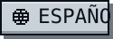
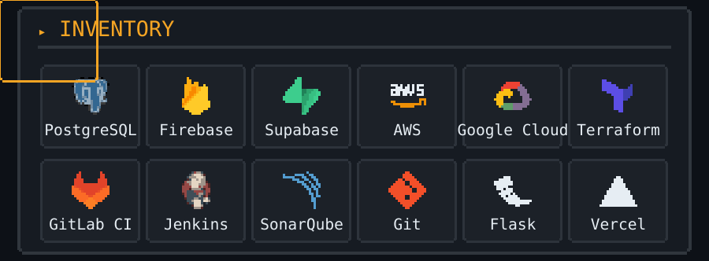
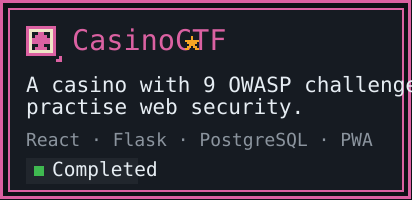
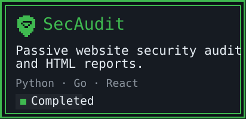
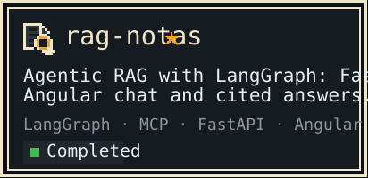
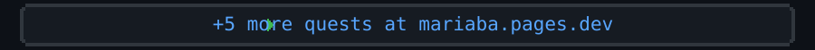

<!-- Generated by gen/build.py: edit data/profile.json and rebuild. -->

<picture>
  <source media="(max-width: 600px)" srcset="https://github.com/laloba04/laloba04/raw/main/assets/en/mobile/hero.svg?v=2f8060bb">
  
</picture>

<picture>
  <source media="(max-width: 600px)" srcset="https://github.com/laloba04/laloba04/raw/main/assets/en/mobile/sheet.svg?v=7e88431c">
  
</picture>

<picture>
  <source media="(max-width: 600px)" srcset="https://github.com/laloba04/laloba04/raw/main/assets/en/mobile/achievements.svg?v=33881b1a">
  
</picture>

<picture>
  <source media="(max-width: 600px)" srcset="https://github.com/laloba04/laloba04/raw/main/assets/en/mobile/inventory.svg?v=5a498f5c">
  
</picture>

<picture>
  <source media="(max-width: 600px)" srcset="https://github.com/laloba04/laloba04/raw/main/assets/en/mobile/quests-title.svg?v=49e9f200">
  
</picture>

 

<a href="https://mariaba.pages.dev/en/projects/">
<picture>
  <source media="(max-width: 600px)" srcset="https://github.com/laloba04/laloba04/raw/main/assets/en/mobile/quests-more.svg?v=14ef5373">
  
</picture>
</a>

<picture>
  <source media="(max-width: 600px)" srcset="https://github.com/laloba04/laloba04/raw/main/assets/en/mobile/night.svg?v=7ef157dd">
  
</picture>

<a href="mailto:mba.maria08@gmail.com">
<picture>
  <source media="(max-width: 600px)" srcset="https://github.com/laloba04/laloba04/raw/main/assets/en/mobile/start.svg?v=994343c0">
  
</picture>
</a>

