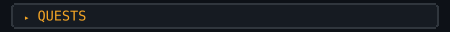
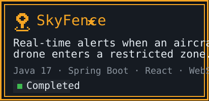

<!-- Generated by gen/build.py: edit data/profile.json and rebuild. -->

<picture>
  <source media="(max-width: 600px)" srcset="https://github.com/laloba04/laloba04/raw/main/assets/en/mobile/hero.svg?v=56f4a6e0">
  
</picture>

<picture>
  <source media="(max-width: 600px)" srcset="https://github.com/laloba04/laloba04/raw/main/assets/en/mobile/sheet.svg?v=fa7746a9">
  
</picture>

<picture>
  <source media="(max-width: 600px)" srcset="https://github.com/laloba04/laloba04/raw/main/assets/en/mobile/achievements.svg?v=1a091d17">
  
</picture>

<picture>
  <source media="(max-width: 600px)" srcset="https://github.com/laloba04/laloba04/raw/main/assets/en/mobile/inventory.svg?v=550dbd4a">
  
</picture>

<picture>
  <source media="(max-width: 600px)" srcset="https://github.com/laloba04/laloba04/raw/main/assets/en/mobile/quests-title.svg?v=76cae405">
  
</picture>

 

<a href="https://mariaba.pages.dev/en/projects/">
<picture>
  <source media="(max-width: 600px)" srcset="https://github.com/laloba04/laloba04/raw/main/assets/en/mobile/quests-more.svg?v=c38414f4">
  
</picture>
</a>

<picture>
  <source media="(max-width: 600px)" srcset="https://github.com/laloba04/laloba04/raw/main/assets/en/mobile/night.svg?v=498f585e">
  
</picture>

<a href="mailto:mba.maria08@gmail.com">
<picture>
  <source media="(max-width: 600px)" srcset="https://github.com/laloba04/laloba04/raw/main/assets/en/mobile/start.svg?v=fced62bc">
  
</picture>
</a>

