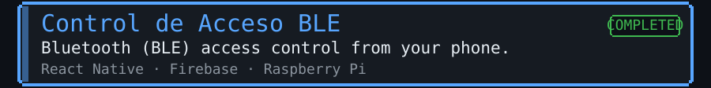
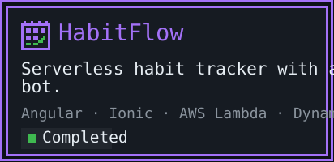

<!-- Generated by gen/build.py: edit data/profile.json and rebuild. -->

**Maria Bravo** · Junior Full Stack & Mobile developer · Barakaldo, Spain

<picture>
  <source media="(max-width: 600px)" srcset="https://github.com/laloba04/laloba04/raw/main/assets/en/mobile/hero.svg?v=60878f7a">
  
</picture>

<picture>
  <source media="(max-width: 600px)" srcset="https://github.com/laloba04/laloba04/raw/main/assets/en/mobile/sheet.svg?v=570e1b5d">
  
</picture>

<picture>
  <source media="(max-width: 600px)" srcset="https://github.com/laloba04/laloba04/raw/main/assets/en/mobile/stats.svg?v=fef3dc21">
  
</picture>

<picture>
  <source media="(max-width: 600px)" srcset="https://github.com/laloba04/laloba04/raw/main/assets/en/mobile/achievements.svg?v=c1d951ec">
  
</picture>

<picture>
  <source media="(max-width: 600px)" srcset="https://github.com/laloba04/laloba04/raw/main/assets/en/mobile/inventory.svg?v=5d6cd5db">
  
</picture>

<picture>
  <source media="(max-width: 600px)" srcset="https://github.com/laloba04/laloba04/raw/main/assets/en/mobile/quests-title.svg?v=7a826c7f">
  
</picture>

<a href="https://mariaba.pages.dev">
<picture>
  <source media="(max-width: 600px)" srcset="https://github.com/laloba04/laloba04/raw/main/assets/en/mobile/quests-more.svg?v=d9d6fdb3">
  
</picture>
</a>

<picture>
  <source media="(max-width: 600px)" srcset="https://github.com/laloba04/laloba04/raw/main/assets/en/mobile/night.svg?v=a2498ec2">
  
</picture>

<a href="mailto:mba.maria08@gmail.com">
<picture>
  <source media="(max-width: 600px)" srcset="https://github.com/laloba04/laloba04/raw/main/assets/en/mobile/start.svg?v=09cd5f4b">
  
</picture>
</a>

