<!-- Archivo generado por gen/build.py: edita data/profile.json y vuelve a generarlo. -->

<a href="https://github.com/laloba04/laloba04/blob/main/README.en.md">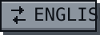</a>

**Maria Bravo** · Desarrolladora Full Stack y Mobile junior · Barakaldo

<picture>
  <source media="(max-width: 600px)" srcset="https://github.com/laloba04/laloba04/raw/main/assets/es/mobile/hero.svg">
  
</picture>

<picture>
  <source media="(max-width: 600px)" srcset="https://github.com/laloba04/laloba04/raw/main/assets/es/mobile/sheet.svg">
  
</picture>

<picture>
  <source media="(max-width: 600px)" srcset="https://github.com/laloba04/laloba04/raw/main/assets/es/mobile/stats.svg">
  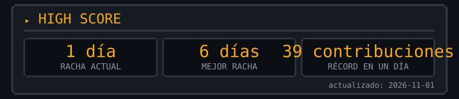
</picture>

<picture>
  <source media="(max-width: 600px)" srcset="https://github.com/laloba04/laloba04/raw/main/assets/es/mobile/achievements.svg">
  
</picture>

<picture>
  <source media="(max-width: 600px)" srcset="https://github.com/laloba04/laloba04/raw/main/assets/es/mobile/inventory.svg">
  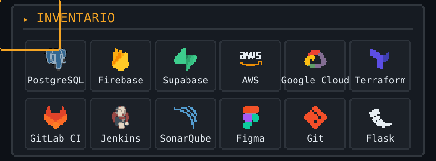
</picture>

<picture>
  <source media="(max-width: 600px)" srcset="https://github.com/laloba04/laloba04/raw/main/assets/es/mobile/quests-title.svg">
  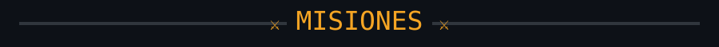
</picture>

<a href="https://mariaba.pages.dev">
<picture>
  <source media="(max-width: 600px)" srcset="https://github.com/laloba04/laloba04/raw/main/assets/es/mobile/quest-skyfence.svg">
  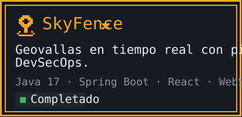
</picture>
</a>

<a href="https://mariaba.pages.dev">
<picture>
  <source media="(max-width: 600px)" srcset="https://github.com/laloba04/laloba04/raw/main/assets/es/mobile/quest-casinoctf.svg">
  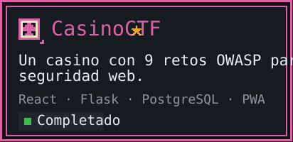
</picture>
</a>

<a href="https://mariaba.pages.dev">
<picture>
  <source media="(max-width: 600px)" srcset="https://github.com/laloba04/laloba04/raw/main/assets/es/mobile/quest-secaudit.svg">
  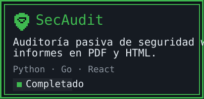
</picture>
</a>

<a href="https://mariaba.pages.dev">
<picture>
  <source media="(max-width: 600px)" srcset="https://github.com/laloba04/laloba04/raw/main/assets/es/mobile/quest-control-acceso-ble.svg">
  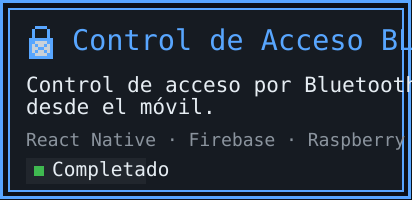
</picture>
</a>

<a href="https://mariaba.pages.dev">
<picture>
  <source media="(max-width: 600px)" srcset="https://github.com/laloba04/laloba04/raw/main/assets/es/mobile/quest-habitflow.svg">
  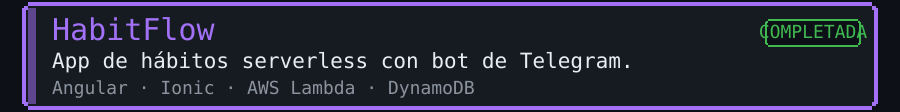
</picture>
</a>

<a href="https://mariaba.pages.dev">
<picture>
  <source media="(max-width: 600px)" srcset="https://github.com/laloba04/laloba04/raw/main/assets/es/mobile/quest-rag-notas.svg">
  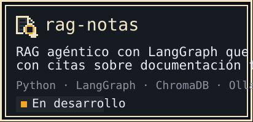
</picture>
</a>

<a href="https://mariaba.pages.dev">
<picture>
  <source media="(max-width: 600px)" srcset="https://github.com/laloba04/laloba04/raw/main/assets/es/mobile/quests-more.svg">
  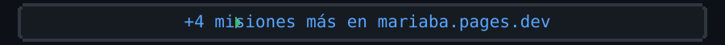
</picture>
</a>

<picture>
  <source media="(max-width: 600px)" srcset="https://github.com/laloba04/laloba04/raw/main/assets/es/mobile/night.svg">
  
</picture>

<a href="mailto:mba.maria08@gmail.com">
<picture>
  <source media="(max-width: 600px)" srcset="https://github.com/laloba04/laloba04/raw/main/assets/es/mobile/start.svg">
  
</picture>
</a>

