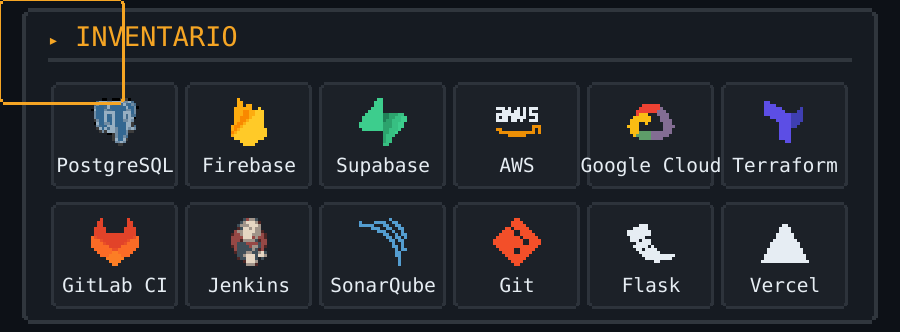
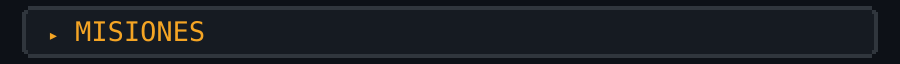
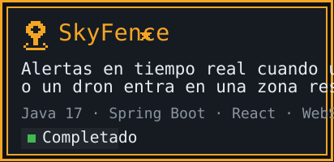
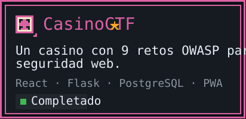
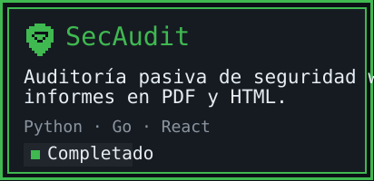
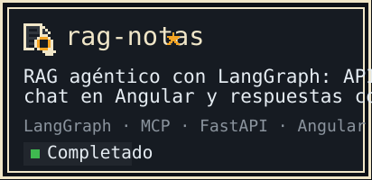
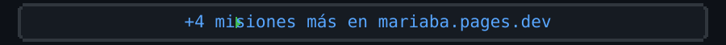

<!-- Archivo generado por gen/build.py: edita data/profile.json y vuelve a generarlo. -->

<picture>
  <source media="(max-width: 600px)" srcset="https://github.com/laloba04/laloba04/raw/main/assets/es/mobile/hero.svg?v=91f65d9c">
  
</picture>

<picture>
  <source media="(max-width: 600px)" srcset="https://github.com/laloba04/laloba04/raw/main/assets/es/mobile/sheet.svg?v=c2a50395">
  
</picture>

<picture>
  <source media="(max-width: 600px)" srcset="https://github.com/laloba04/laloba04/raw/main/assets/es/mobile/achievements.svg?v=c770a848">
  
</picture>

<picture>
  <source media="(max-width: 600px)" srcset="https://github.com/laloba04/laloba04/raw/main/assets/es/mobile/inventory.svg?v=3de8550d">
  
</picture>

<picture>
  <source media="(max-width: 600px)" srcset="https://github.com/laloba04/laloba04/raw/main/assets/es/mobile/quests-title.svg?v=3c876701">
  
</picture>

 

<a href="https://mariaba.pages.dev/proyectos/">
<picture>
  <source media="(max-width: 600px)" srcset="https://github.com/laloba04/laloba04/raw/main/assets/es/mobile/quests-more.svg?v=bc414443">
  
</picture>
</a>

<picture>
  <source media="(max-width: 600px)" srcset="https://github.com/laloba04/laloba04/raw/main/assets/es/mobile/night.svg?v=a93051aa">
  
</picture>

<a href="mailto:mba.maria08@gmail.com">
<picture>
  <source media="(max-width: 600px)" srcset="https://github.com/laloba04/laloba04/raw/main/assets/es/mobile/start.svg?v=0b98547d">
  
</picture>
</a>

